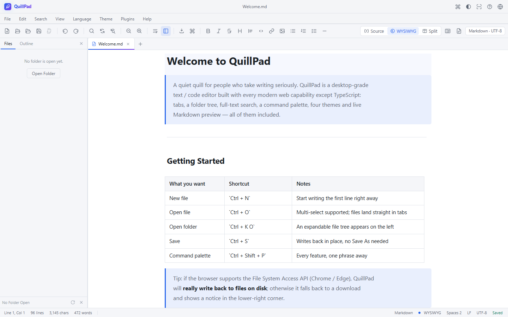
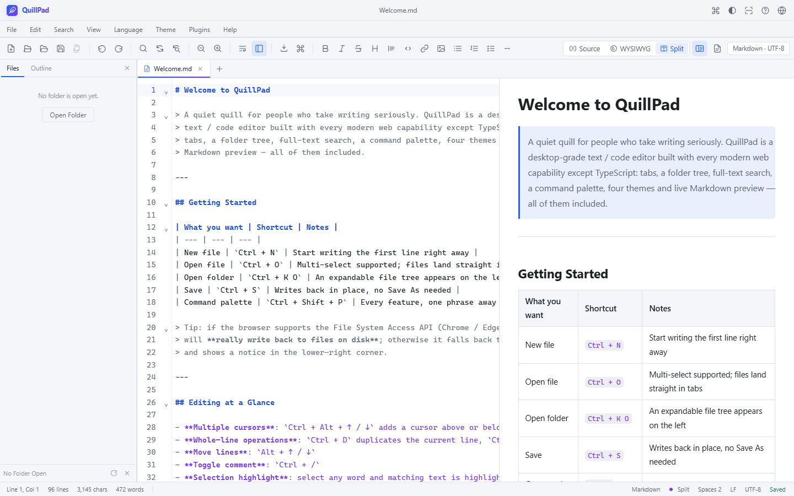
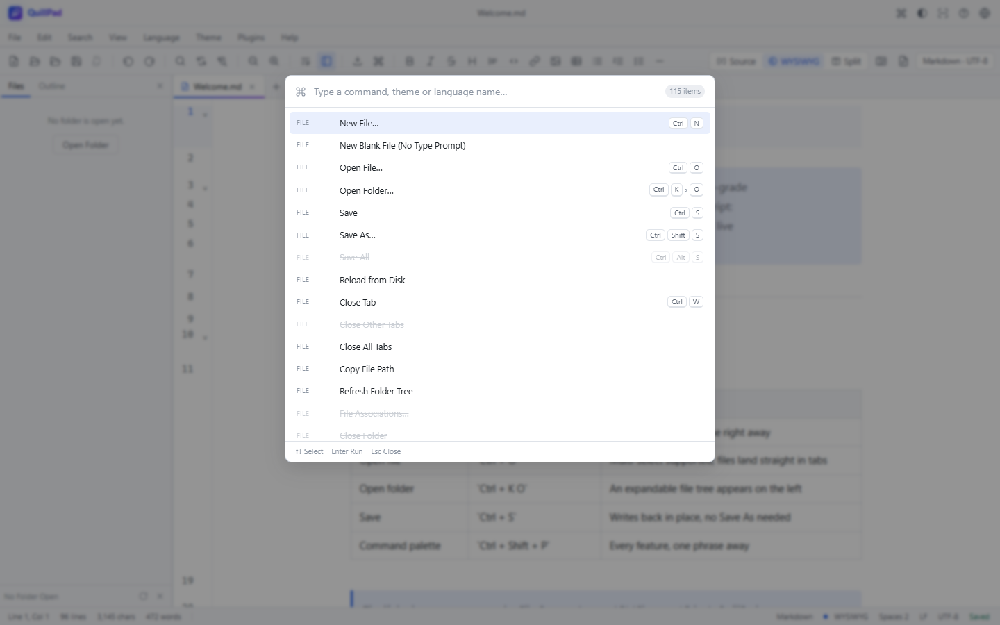
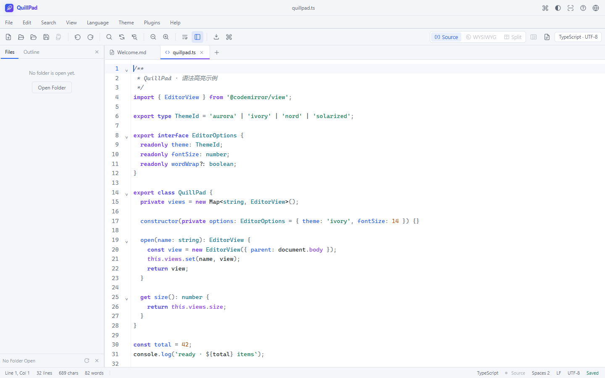

# QuillPad

[简体中文](README.md) · **English**

> A modern alternative to Notepad++ — with Typora-class WYSIWYG Markdown, colorized PDF export, and a plugin ecosystem.

[](https://github.com/Frank-TCA/quillpad-desktop/actions/workflows/ci.yml)
[](LICENSE)
[](https://www.electronjs.org/)
[](https://codemirror.net/)
[](https://vitejs.dev/)

> **Name notice**: this project is a Windows desktop editor. It has **no affiliation** with the
> identically named Android note-taking app [Quillpad](https://github.com/quillpad/quillpad)
> (Kotlin, GPL-3.0). The two projects are independent and share no code.

---



## Why QuillPad

Notepad++ is the most dependable lightweight editor on Windows, but it is frozen in a 2003-era
interaction model: Markdown is source-only, PDF export needs third-party tooling, and the plugin
ecosystem is tied to Win32 and the GPL.

QuillPad keeps the whole Notepad++ feel — multiple tabs, syntax highlighting, find & replace, macros,
column editing, session restore, shell integration — and promotes what modern writing actually needs
to first-class features:

- **WYSIWYG Markdown**: headings, tables, math, and task lists render in place like Typora, while the source stays editable
- **Colorized PDF export**: rendered with the syntax palette of the current theme and real subsets of the CJK fonts — not a screenshot
- **English / Chinese UI**: switch with one click — menus, dialogs, toasts, and the built-in welcome document all follow, no restart
- **Commercially friendly plugin ecosystem**: MIT / Apache / BSD licensed, running inside a Worker sandbox instead of DLL injection
- **40 languages / 100+ file extensions** highlighted out of the box, zero configuration

## Features

### Editor core

| Capability | Details |
| --- | --- |
| Three view modes | Source / WYSIWYG / split, switch with `Ctrl+Shift+1/2/3`; WYSIWYG keeps the line-number column and fold arrows too, aligned row by row with the text |
| Syntax highlighting | 40 languages across 100+ extensions, grouped by family (web, data, scripting, systems, documents) |
| Multi-cursor & column selection | `Ctrl+Alt+↑/↓` to add cursors; rectangular insert, delete, align, and numbering |
| Find & replace | Regex, whole word, case sensitivity, in-selection replace, 20-entry history |
| Macro recording | Record → replay → persist, surviving restarts |
| Text marking | 5 highlight colors (red, yellow, green, blue, purple), remapped as you edit, one-click from the context menu |
| Editing aids | Word wrap, indent guides, minimap, bracket matching, Tab stops |
| Session restore | Unsaved content, cursor positions, and scroll positions all come back |

### Markdown authoring

- Inline rendering: headings, bold/italic, strikethrough, inline code, links, blockquotes, lists, task items
- Block elements: fenced code (with syntax highlighting), tables (add/remove rows and columns, per-column alignment), images, KaTeX math, footnotes, table of contents
- Click a cell to edit it, `Tab` moves between cells; click the blank space beside a table to park the cursor outside it — `Delete` at the left edge or `Backspace` at the right edge removes the whole table (the opposite key just deletes one character)
- Drag or paste an image and it is written to an `assets/` folder next to the document, with a random suffix on name collisions
- The WYSIWYG surface adapts to window width, so wide screens no longer waste the margins

### PDF export

- A dozen-plus settings in the export dialog: file name and save location, page size (with custom width/height), orientation, four margins, theme, code theme, max image width, page numbers, table of contents, and header/footer with their text
- Syntax colors **follow the active theme**, or pin one of github-light / one-dark / solarized
- Fonts are inlined as `data:` URIs, images inlined or replaced with placeholders — self-contained, no external links, no scripts
- Real subsets of Noto Sans SC embedded for CJK text

### Plugin ecosystem

- Plugins run in a **module Worker sandbox**; the main thread authorizes each call and kills a plugin after a 5-second heartbeat timeout
- Permission model: `editor:read` / `editor:write` / `files:read` / `files:write` / `clipboard` / `network` / `settings`
- License allowlist: only MIT / Apache-2.0 / BSD / ISC / 0BSD
- Plugin manager: search, categories, sorting, four-state status, permission prompts, second confirmation for high-risk permissions
- 3 built-in official MIT plugin packages (21 commands and 1 sidebar view); every command ships a `Ctrl+Alt+letter` shortcut declared in the package's `plugin.json` and activated on install
- Plus 4 one-click installable community packages (JSON formatter / JSON Schema reference / CSV to JSON / line sorter); the `sha256` of each zip is verified before install, and anything that cannot actually install is kept out of the catalog
- "Import from Notepad++" wizard: scans your local plugin folder and produces a compatibility report

### Interface

- Four themes: Aurora (dark), Ivory (light, default), Nord (dark), Solarized (light)
- Five-pane layout: menu bar, toolbar, tab bar, editor, status bar
- Context menus everywhere: editor (including the 5 marking colors), tab bar (including a file menu on empty space), toolbar, menu bar
- Tab bar supports horizontal wheel scrolling and left/right arrow navigation when tabs overflow
- `Ctrl + wheel` to zoom the editor font size
- Command palette (`Ctrl+Shift+P`) pulls built-in and plugin commands into one entry point
- English / Chinese UI: the globe button in the title bar, or Help → Language — takes effect immediately, no restart
- The built-in welcome document follows the UI language (`欢迎.md` / `Welcome.md`) and keeps your edits intact
- Complete keyboard shortcut reference (`F1`)

<table>
<tr>
<td width="50%"></td>
<td width="50%"></td>
</tr>
<tr>
<td align="center">Split view: source and preview scroll together</td>
<td align="center">Command palette: <code>Ctrl+Shift+P</code> reaches everything</td>
</tr>
</table>



## Download and install

Get the latest build from [Releases](https://github.com/Frank-TCA/quillpad-desktop/releases):

| File | Description |
| --- | --- |
| `QuillPad-Setup-v1.0.4.exe` | Installer: choose the install directory, desktop and Start menu shortcuts, a **file-association page (tick to make QuillPad the default)**, shell context-menu integration, trace-cleaning uninstaller |
| `QuillPad-v1.0.4-portable.exe` | Portable: single file, no installation, data in a sibling `QuillPad-Data/` folder — delete it and nothing is left behind |
| `QuillPad-Uninstaller-v1.0.4.exe` | Standalone uninstaller (~80 KB): scans and deep-cleans installation directories, user data, shortcuts, file associations, and registry leftovers from **previous versions**; only needed for the installer build |

**File associations**: the installer has a *File Associations* page — four groups (Markdown / plain text & logs / 31 code types / 15 config & data types, 50 extensions in total, all ticked by default). Ticked types become the **actual default** and open in QuillPad on double-click. You can change it later via **menu → File → File Associations…** (filled from the registry's real state, only the groups that differ are written) or jump to Windows' *Default apps* page. Unattended deployment that must not touch defaults: `/S /NOASSOC`.

**Uninstalling**: for the installer build, use the Start menu "Uninstall QuillPad" entry, `Uninstall QuillPad.exe` in the install directory, Windows Settings → Apps, or the standalone uninstaller above. All four run the same trace manifest (`build/traces.nsh`), so the result is identical. The portable build writes no registry keys — just delete the exe and `QuillPad-Data/`.

> **Unsigned build notice**: this project does not carry a code-signing certificate, so Windows may show "Windows protected your PC" on first launch. Click "More info" → "Run anyway".

**Requirements**: Windows 10 or 11 (x64)

## Build from source

```bash
# Requires Node.js 20+ and npm 10+
git clone https://github.com/Frank-TCA/quillpad-desktop.git
cd quillpad-desktop
npm install

# Development mode (browser)
npm run dev

# Development mode (Electron shell)
npm run desktop

# Build the renderer bundle into dist/
npm run build

# Package the Windows installer, portable build, and standalone uninstaller into dist/release/
npm run build:exe

# Build one artifact at a time
npm run build:installer    # NSIS installer + uninstaller
npm run build:portable     # portable build only
npm run build:uninstaller  # standalone uninstaller only
```

Build output always goes to `dist/` (renderer) and `dist/release/` (installers); there are no per-version directories.

## Testing

```bash
# Terminal A: start a local server on http://localhost:4173 (every "needs a server" line hits it)
npm run build && npm run preview     # built output; or `npm run app` for the dev server

# Terminal B: run the tests
npm test              # unit + integration (7 of the 11 suites need the server, see below)
npm run test:v2       # end-to-end acceptance (needs the server)
npm run test:e2e:full # full end-to-end suite (slow; needs the server)
npm run test:visual   # screenshot + visual regression (needs the server)
npm run test:v2:unit  # pure-function unit tests (plain Node, no server)
npm run license:check # dependency license compliance (plain Node, no server)

# Release gates (run before shipping)
npm run test:i18n        # static bilingual gate: exits 1 on any missing translation
npm run test:plugins     # plugin data / packaging / keybindings (209 checks)
npm run test:desktop     # desktop shell connectivity
npm run test:plugins:ui  # plugin manager uninstall + install dialog (real Electron, 14 checks)
npm run test:uninstall   # uninstall trace manifest (37 checks); add -- --verify-clean for the 49 post-uninstall residue checks
npm run test:installed   # post-install smoke test (37 checks; runs the installed exe, so install first)
```

`npm test` chains 11 suites; **seven of them need** something serving
`http://localhost:4173`: menu-fix-check / smoke / p1-check / find-panel-check /
statusbar-check / edit-ops-check / newfile-check. Without a server the very first one
fails with `ERR_CONNECTION_REFUSED`. The remaining four (v2-unit / data-check /
plugin-pack-check / plugin-keys-check) are plain Node and need no server.

The first two release gates are plain Node and CI-friendly; the rest need a real Electron
shell or an installed build (`test:installed` exercises the installed exe, not the source),
so run them by hand before tagging a release.

```bash
# Regenerate the README screenshots (always Ivory Light; one set per UI language; needs the preview server)
npm run readme:shots
```

## Tech stack

| Layer | Choice | License |
| --- | --- | --- |
| Editor core | [CodeMirror 6](https://codemirror.net/) | MIT |
| Markdown | [marked](https://marked.js.org/) | MIT |
| Math | [KaTeX](https://katex.org/) | MIT |
| Desktop shell | [Electron](https://www.electronjs.org/) | MIT |
| Build | [Vite](https://vitejs.dev/) + [electron-builder](https://www.electron.build/) | MIT |
| Fonts | Noto Sans SC / JetBrains Mono | SIL OFL 1.1 |

Every dependency uses a commercially friendly license — **no GPL, AGPL, or SSPL anywhere**. See
[THIRD-PARTY-NOTICES.txt](THIRD-PARTY-NOTICES.txt) for the full list.

## Project layout

```
.
├── src/                     Renderer source
│   ├── app.js               Application wiring and lifecycle
│   ├── core/                State, commands, settings, filesystem, printing, i18n
│   ├── editor/              CodeMirror extensions (languages, themes, WYSIWYG, marking)
│   ├── ui/                  Hand-rolled UI components (menus, toolbar, tabs, dialogs)
│   ├── styles/              CSS variable themes and component styles
│   └── data/                Language definitions, plugin catalog
├── desktop/                 Electron main process and preload
├── build/                   Icon generation, afterPack hook, installer scripts
├── public/                  Static assets (plugin packages, compatibility maps)
├── scripts/                 Test, build, and screenshot helper scripts
├── docs/                    Architecture diagrams (Mermaid) and README screenshots (`en/` = English UI)
└── licenses/                License texts shipped with the app
```

## Docs

- [USER-GUIDE.en.md](USER-GUIDE.en.md) — English user guide: installer / portable / four uninstall entry points / trace cleanup / PDF export / shortcuts
- [USER-GUIDE.zh-CN.md](USER-GUIDE.zh-CN.md) — Chinese user guide (same content, 简体中文)
- [CHANGELOG.md](CHANGELOG.md) — version history
- [docs/](docs/) — architecture diagrams (Mermaid: class, sequence); `docs/screenshots/` holds the README images (`en/` = English UI)
- [CONTRIBUTING.md](CONTRIBUTING.md) — contribution guide
- [docs/plugin-api.md](docs/plugin-api.md) — plugin development: manifest fields, permissions, API reference, sandbox limits

## Contributing

Issues and pull requests are welcome. Please read [CONTRIBUTING.md](CONTRIBUTING.md) first
(written in Chinese; English contributions are fine).

- 🐛 [Report a bug](https://github.com/Frank-TCA/quillpad-desktop/issues/new?template=bug_report.yml)
- 💡 [Request a feature](https://github.com/Frank-TCA/quillpad-desktop/issues/new?template=feature_request.yml)
- 🔌 Writing plugins: [plugin API](docs/plugin-api.md) (manifest fields, 7 permissions, 9 API groups, sandbox limits)

## License

Released under the [MIT License](LICENSE).

Third-party licenses and the full OFL text for bundled fonts are in
[THIRD-PARTY-NOTICES.txt](THIRD-PARTY-NOTICES.txt) and [licenses/](licenses/).
