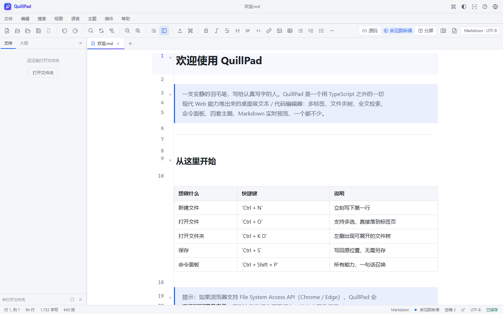
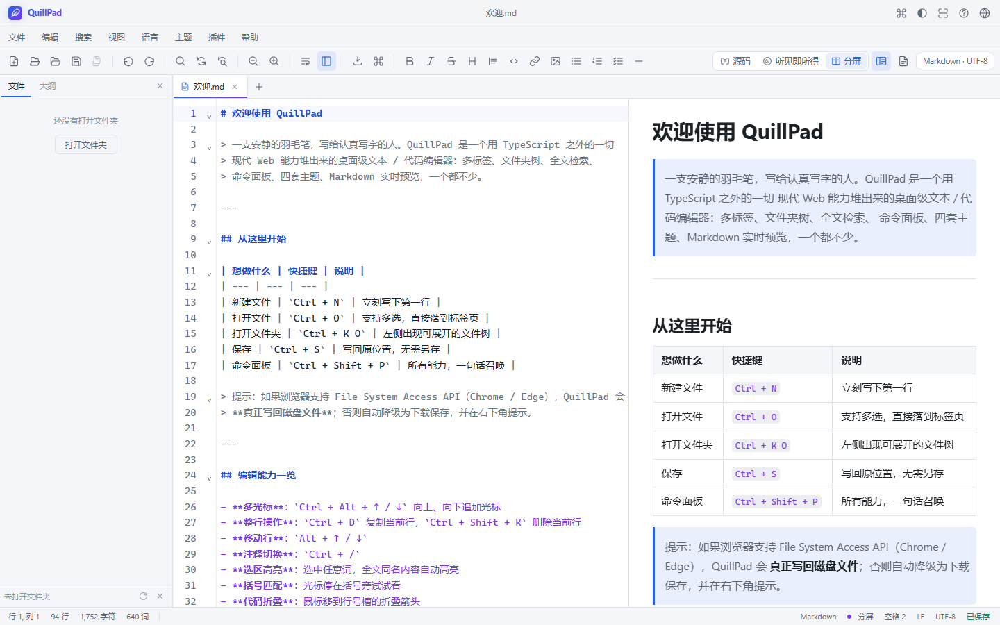
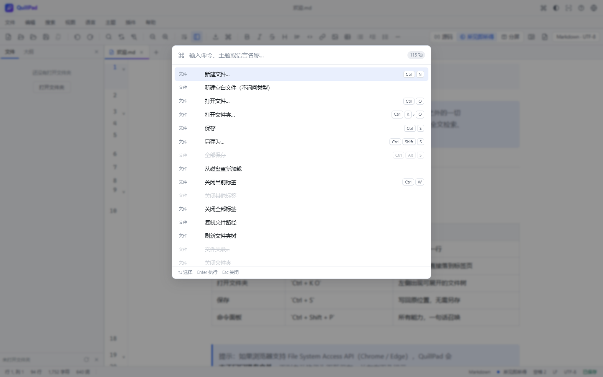
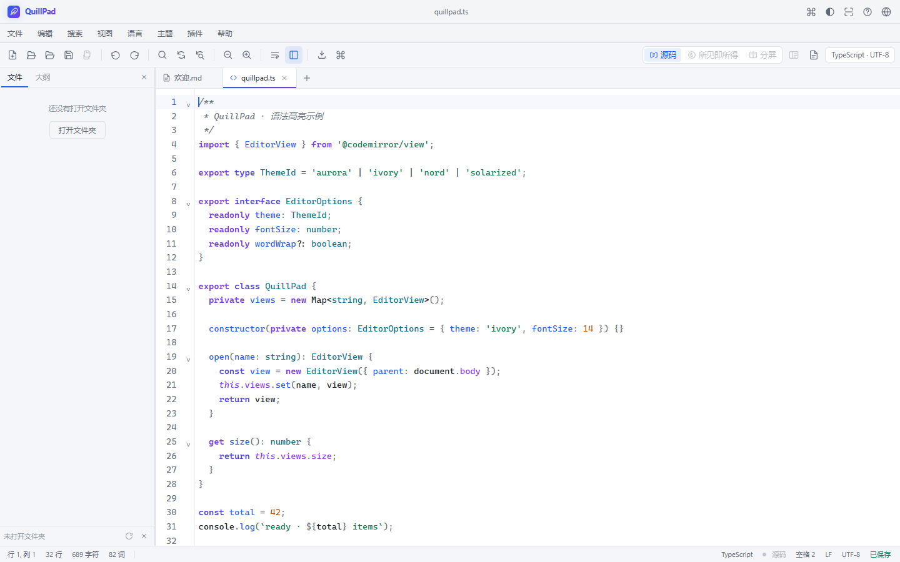

# QuillPad

**简体中文** · [English](README.en.md)

> 面向 Notepad++ 用户的现代替代品 —— 内置 Typora 级 Markdown 所见即所得、彩色 PDF 导出与插件生态。

[](https://github.com/Frank-TCA/quillpad-desktop/actions/workflows/ci.yml)
[](LICENSE)
[](https://www.electronjs.org/)
[](https://codemirror.net/)
[](https://vitejs.dev/)

> **命名说明**：本项目是 Windows 桌面编辑器，与 GitHub 上同名的 Android 笔记应用
> [Quillpad](https://github.com/quillpad/quillpad)（Kotlin，GPL-3.0）没有任何关系 ——
> 两者互不隶属，代码无交集。

---



## 为什么是 QuillPad

Notepad++ 是 Windows 上最可靠的轻量编辑器，但它停在 2003 年的交互模型里：Markdown 只能看源码、导出 PDF 要装第三方工具、插件生态绑定 Win32 与 GPL。

QuillPad 保留了 Notepad++ 的全部手感 —— 多标签、语法高亮、查找替换、宏、列编辑、会话恢复、右键菜单集成 —— 同时把现代写作需要的东西做成第一等公民：

- **Markdown 所见即所得**：像 Typora 一样就地渲染标题、表格、公式、任务项，同时保留源码可编辑性
- **彩色 PDF 导出**：按当前主题的语法配色渲染，中文字体真子集嵌入，不是截图
- **中英双语界面**：一键切换，菜单、对话框、状态提示与内置欢迎文档一起换，不用重启
- **商业友好的插件生态**：MIT/Apache/BSD，运行在 Worker 沙箱里，而不是 DLL 注入
- **40 种语言 / 100+ 文件扩展名**，零配置开箱可用

## 功能一览

### 编辑器内核

| 能力 | 说明 |
| --- | --- |
| 三种视图 | 源码 / 所见即所得 / 分栏，`Ctrl+Shift+1/2/3` 直切 |
| 语法高亮 | 40 种语言、100+ 扩展名，按语系分组（Web、数据、脚本、系统、文档） |
| 多光标与列选择 | `Ctrl+Alt+↑/↓` 加光标，矩形选区的插入/删除/对齐/编号 |
| 查找替换 | 正则、全词、大小写、范围内替换、查找历史（20 条） |
| 宏录制 | 录制 → 回放 → 持久化，跨会话保留 |
| 文本标记 | 5 色高亮（红/黄/绿/蓝/紫），随编辑自动映射，右键一键标记 |
| 编辑增强 | 自动换行、缩进参考线、小地图、括号匹配、Tab 跳格 |
| 会话恢复 | 未保存内容、光标位置、滚动位置全部还原 |

### Markdown 写作

- 就地渲染：标题、粗斜体、删除线、行内代码、链接、引用、列表、任务项
- 块级元素：代码块（带语法高亮）、表格（增删行列 / 列对齐）、图片、KaTeX 公式、脚注、目录
- 表格单击选中整块，双击进入单元格；`Tab` 跳格
- 图片拖拽或粘贴自动落盘到文档同目录 `assets/`，同名自动加随机后缀
- WYSIWYG 编辑面自适应窗口宽度，宽屏不再浪费两侧空间

### PDF 导出

- 导出对话框十余项设置：文件名与保存位置、纸张（含自定义宽高）、方向、四边距、主题、代码配色、图片最大宽度、页码、目录页、页眉页脚及文字
- 语法配色**跟随当前主题**（也可指定 github-light / one-dark / solarized）
- 字体以 `data:` 内联，图片内联或占位 —— 自包含，无外链、无脚本
- 中文字体（Noto Sans SC）真子集嵌入

### 插件生态

- 插件运行在 **module Worker 沙箱**，主线程逐次鉴权，5 秒心跳无响应即终止
- 权限模型：`editor:read` / `editor:write` / `files:read` / `files:write` / `clipboard` / `network` / `settings`
- License 白名单：仅允许 MIT / Apache-2.0 / BSD / ISC / 0BSD
- 插件管理器：搜索、分类、排序、四态状态、权限确认、高风险二次确认
- 内置 3 个官方 MIT 插件包（21 条命令 + 1 个侧栏视图），每条命令都带 `Ctrl+Alt+字母` 快捷键，键位在包内 `plugin.json` 声明、装包即生效
- 市场另有 4 个可一键安装的社区包（JSON 格式化 / JSON Schema 速查 / CSV 转 JSON / 行排序增强），安装前校验 `sha256`；装不上的包不进目录
- 「从 Notepad++ 导入」向导：扫描本机插件目录，输出兼容性报告

### 界面

- 四套主题：Aurora（暗）/ Ivory（亮，默认）/ Nord（暗）/ Solarized（亮）
- 五栏布局：菜单栏 / 工具栏 / 标签栏 / 编辑区 / 状态栏
- 全上下文右键菜单：编辑区（含 5 色标记）、标签栏（含空白处文件菜单）、工具栏、菜单栏
- 标签栏溢出时支持滚轮横向滚动与左右箭头导航
- `Ctrl + 滚轮` 缩放字号
- 命令面板（`Ctrl+Shift+P`）把内置命令与插件命令收进同一个入口
- 中英双语界面：标题栏地球按钮，或「帮助 → 界面语言」切换，即时生效、无需重启
- 内置欢迎文档随界面语言切换（`欢迎.md` / `Welcome.md`），你自己的修改不会被覆盖
- 完整快捷键速查表（`F1`）

<table>
<tr>
<td width="50%"></td>
<td width="50%"></td>
</tr>
<tr>
<td align="center">分栏视图：源码与预览同步滚动</td>
<td align="center">命令面板：<code>Ctrl+Shift+P</code> 调用全部功能</td>
</tr>
</table>



## 下载安装

从 [Releases](https://github.com/Frank-TCA/quillpad-desktop/releases) 下载最新版本：

| 文件 | 说明 |
| --- | --- |
| `QuillPad-Setup-v1.0.0.exe` | 安装版：可选安装目录、桌面/开始菜单快捷方式、右键菜单集成、卸载清理痕迹 |
| `QuillPad-v1.0.0-portable.exe` | 便携版：单文件免安装，数据写在同级 `QuillPad-Data/`，删掉即彻底清除 |
| `QuillPad-Uninstaller-v1.0.0.exe` | 独立卸载器（约 80 KB）：自带扫描与深度清理，能连历史版本的安装目录、用户数据、快捷方式与注册表残留一起收掉；仅安装版需要 |

**卸载方式**：安装版可通过开始菜单「卸载 QuillPad」、安装目录下的 `Uninstall QuillPad.exe`、Windows「设置 → 应用」、或上面的独立卸载器任选其一，四者执行同一份痕迹清单（`build/traces.nsh`），效果一致。便携版不写注册表，直接删除 exe 与 `QuillPad-Data/` 即可。

> **未签名提示**：本项目未购买代码签名证书，首次运行 Windows 会提示「已保护你的电脑」。点「更多信息」→「仍要运行」即可。

**系统要求**：Windows 10 / 11（x64）

## 从源码构建

```bash
# 环境：Node.js 20+，npm 10+
git clone https://github.com/Frank-TCA/quillpad-desktop.git
cd quillpad-desktop
npm install

# 开发模式（浏览器）
npm run dev

# 开发模式（Electron 桌面壳）
npm run desktop

# 构建前端产物到 dist/
npm run build

# 打包 Windows 安装版 + 便携版 + 独立卸载器到 dist/release/
npm run build:exe

# 单独打某一种
npm run build:installer    # NSIS 安装包 + 卸载器
npm run build:portable     # 仅便携版
npm run build:uninstaller  # 仅独立卸载器
```

构建产物统一输出到 `dist/`（前端）与 `dist/release/`（安装包），不按版本号另建目录。

## 测试

```bash
# 终端 A：起本地服务（http://localhost:4173），下面标注「需服务」的命令都打这个地址
npm run build && npm run preview     # 跑构建产物；或 npm run app 起开发服务器

# 终端 B：跑测试
npm test              # 单元 + 集成（11 套里 7 套需服务在线，见下）
npm run test:v2       # 端到端验收（需服务在线）
npm run test:e2e:full # 完整端到端套件（较慢，需服务在线）
npm run test:visual   # 截图 + 视觉回归（需服务在线）
npm run test:v2:unit  # 纯函数单元测试（纯 Node，不需要服务）
npm run license:check # 依赖 License 合规检查（纯 Node，不需要服务）

# 发布闸门（发版前跑一遍）
npm run test:i18n        # 双语漏翻静态闸门：有漏翻即 exit 1
npm run test:plugins     # 插件包数据 / 打包 / 键位（209 项）
npm run test:desktop     # 桌面壳连通性
npm run test:plugins:ui  # 插件管理器卸载 + 安装对话框（真实 Electron，14 项）
npm run test:uninstall   # 卸载痕迹清单（37 项）；加 -- --verify-clean 校验卸载后 49 项残留
npm run test:installed   # 装机后验收（37 项；跑的是已安装的 exe，需先装好新版）
```

`npm test` 串联 11 套，其中 **7 套需要** `http://localhost:4173` 有服务：menu-fix-check /
smoke / p1-check / find-panel-check / statusbar-check / edit-ops-check / newfile-check；
没起服务时首条就 `ERR_CONNECTION_REFUSED`。剩下 4 套（v2-unit / data-check /
plugin-pack-check / plugin-keys-check）是纯 Node，不需要服务。

发布闸门里前两条是纯 Node、可直接进 CI；后面几条要真实 Electron 或已安装的版本
（`test:installed` 跑的是装好的 exe，不读源码），发版前手工跑一遍。

```bash
# 重新生成 README 里的界面截图（固定 Ivory Light，中英文各一套，需 preview 服务在线）
npm run readme:shots
```

## 技术栈

| 层 | 选型 | 许可 |
| --- | --- | --- |
| 编辑器内核 | [CodeMirror 6](https://codemirror.net/) | MIT |
| Markdown | [marked](https://marked.js.org/) | MIT |
| 数学公式 | [KaTeX](https://katex.org/) | MIT |
| 桌面壳 | [Electron](https://www.electronjs.org/) | MIT |
| 构建 | [Vite](https://vitejs.dev/) + [electron-builder](https://www.electron.build/) | MIT |
| 字体 | Noto Sans SC / JetBrains Mono | SIL OFL 1.1 |

全部依赖均为商业友好许可，**不含 GPL / AGPL / SSPL**。完整清单见 [THIRD-PARTY-NOTICES.txt](THIRD-PARTY-NOTICES.txt)。

## 项目结构

```
.
├── src/                     渲染进程源码
│   ├── app.js               应用装配与生命周期
│   ├── core/                状态、命令、设置、文件系统、打印、i18n
│   ├── editor/              CodeMirror 扩展（语言、主题、WYSIWYG、标记）
│   ├── ui/                  自绘界面组件（菜单、工具栏、标签、对话框）
│   ├── styles/              CSS 变量主题与组件样式
│   └── data/                语言定义、插件目录
├── desktop/                 Electron 主进程与 preload
├── build/                   图标生成、afterPack 钩子、安装器脚本
├── public/                  静态资源（插件包、兼容映射）
├── scripts/                 测试与构建辅助脚本
├── docs/                    架构图（Mermaid）与 README 界面截图（`en/` 为英文界面）
└── licenses/                随包分发的许可全文
```

## 文档

- [USER-GUIDE.zh-CN.md](USER-GUIDE.zh-CN.md) —— 中文使用说明：安装版 / 便携版 / 四种卸载入口 / 痕迹清理 / PDF 导出 / 快捷键
- [USER-GUIDE.en.md](USER-GUIDE.en.md) —— English user guide: installer / portable / four uninstall entry points / trace cleanup / PDF export / shortcuts
- [CHANGELOG.md](CHANGELOG.md) —— 版本变更记录
- [docs/](docs/) —— 架构图（Mermaid 类图 / 时序图）；`docs/screenshots/` 是 README 用的界面截图（`en/` 为英文界面）
- [CONTRIBUTING.md](CONTRIBUTING.md) —— 贡献指南
- [docs/plugin-api.md](docs/plugin-api.md) —— 插件开发：清单字段、权限、API 参考、沙箱限制

## 贡献

欢迎提交 Issue 与 Pull Request。请先阅读 [CONTRIBUTING.md](CONTRIBUTING.md)。

- 🐛 [报告 Bug](https://github.com/Frank-TCA/quillpad-desktop/issues/new?template=bug_report.yml)
- 💡 [功能建议](https://github.com/Frank-TCA/quillpad-desktop/issues/new?template=feature_request.yml)
- 🔌 编写插件：[插件 API](docs/plugin-api.md)（清单字段、7 种权限、9 组 API、沙箱限制）

## 许可

本项目以 [MIT License](LICENSE) 开源。

第三方组件许可与字体 OFL 全文见 [THIRD-PARTY-NOTICES.txt](THIRD-PARTY-NOTICES.txt) 与 [licenses/](licenses/)。
